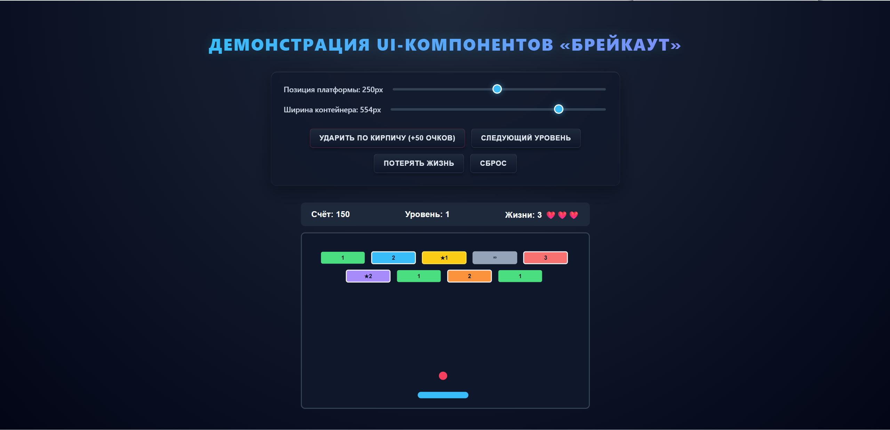
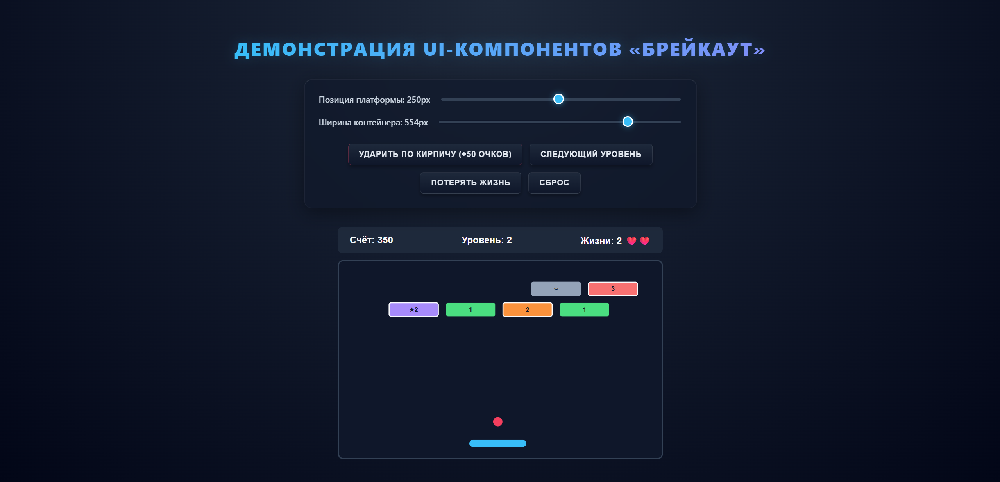

# Лабораторная работа №4 — Библиотека UI-компонентов «Брейкаут»

## Описание проекта
Решение состоит из двух проектов на языке TypeScript с использованием ES6-модулей:
1. **`ui-library`** — библиотека React-компонентов (`BreakoutBoard`, `GameStatusPanel`).
2. **`frontend`** — веб-приложение для демонстрации работы компонентов.

## Инструкция по запуску

### 1. Сборка библиотеки компонентов (`ui-library`)
```bash
cd ui-library
npm install
npm run build
```

### 2. Запуск демонстрационного приложения (`frontend`)
```bash
cd ../frontend
npm install
npm run dev
```

После выполнения команды откройте в браузере локальный адрес (например, `http://localhost:5173`), указанный в терминале.

## Примеры работы приложения

**Общий вид интерфейса:**


**Взаимодействие с приложением (с некоторыми изменениями):**
